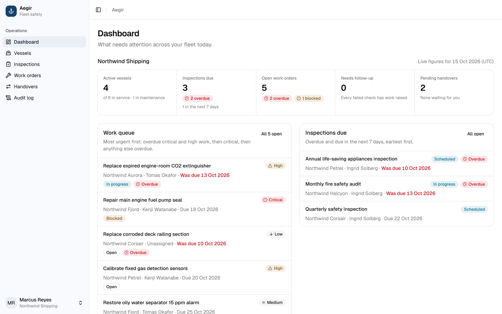
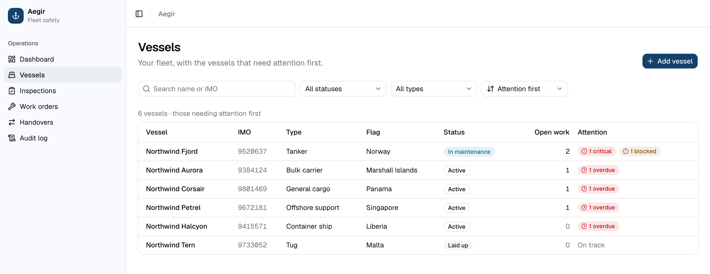
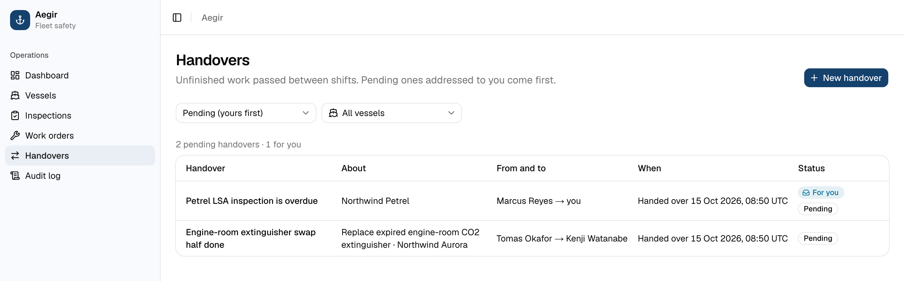
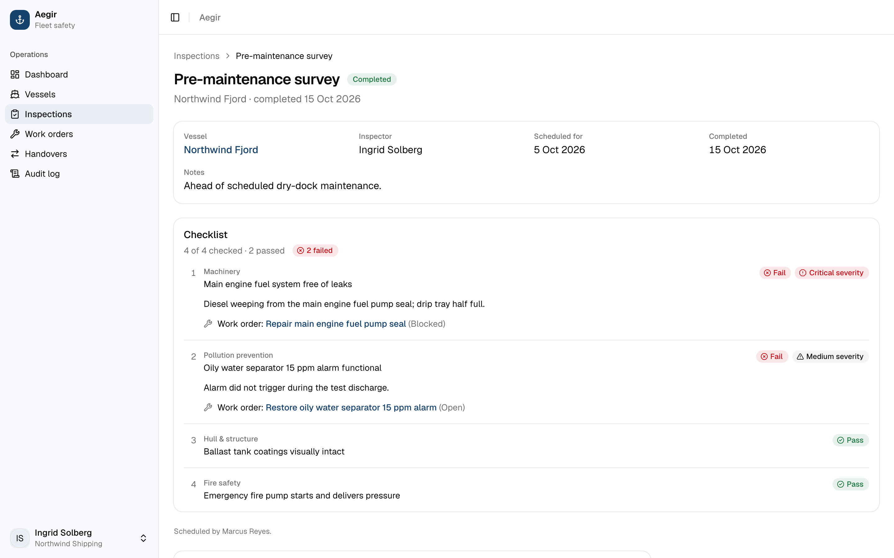
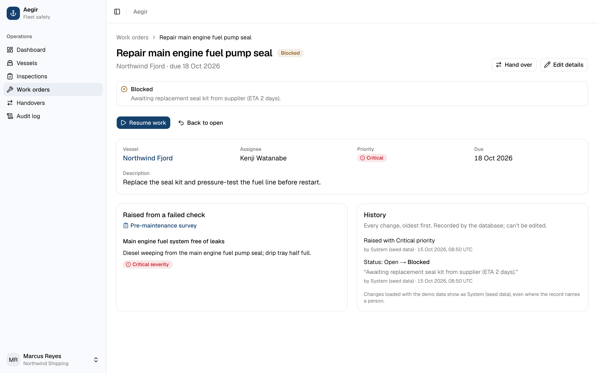
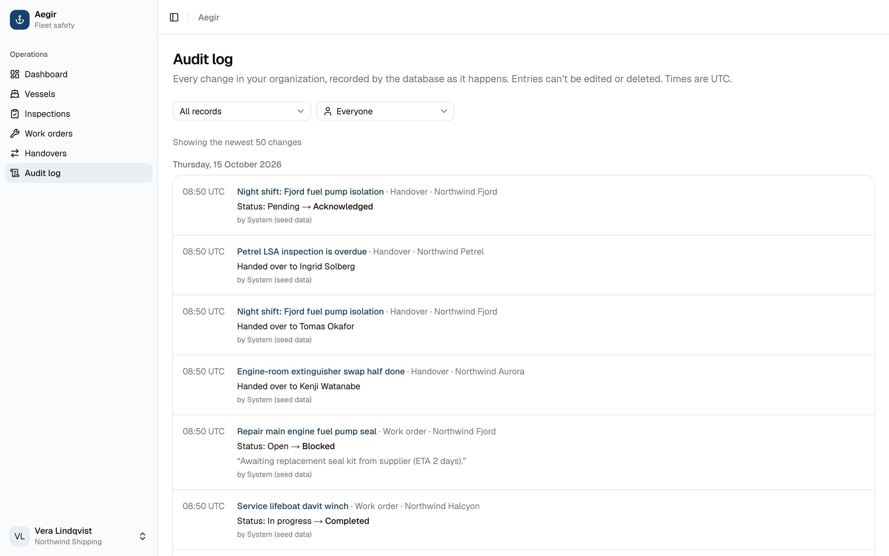
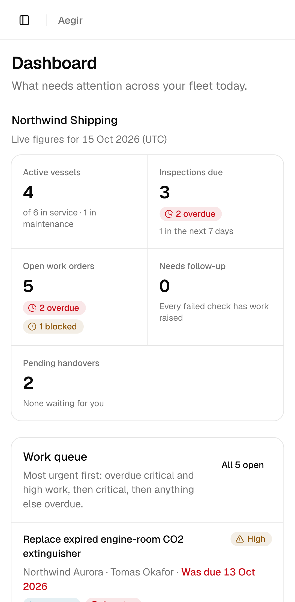

# Aegir

[](https://github.com/Enriquez-Johnmark/aegir/actions/workflows/ci.yml)

**Maritime safety and fleet operations management.** Vessels, safety inspections, work orders and shift handovers in one audited, multi-tenant workspace.

> Portfolio project, under active development. Synthetic data only. Aegir is **not** a certified maritime safety system and makes no regulatory compliance claims.

**Live demo: [aegir-eight.vercel.app](https://aegir-eight.vercel.app)** · sign in with a [demo account](#demo-access).

**Status:** MVP complete and deployed (Vercel + Supabase Cloud): dashboard, vessels, inspections, work orders, handovers and the audit log are live. An independent review (security, database, tests, docs) found no critical issues; its fixes are in [D-043](docs/DECISIONS.md#d-043). See the [roadmap](docs/ROADMAP.md).

## Screenshots

Taken from the live demo with the published accounts (synthetic data). Refresh with `DEMO_PASSWORD=… node scripts/capture-screenshots.mjs` (needs `npx playwright install chromium` once).



| | |
|---|---|
|  |  |
| **Vessels:** the watch list puts critical, blocked and overdue work first. | **Handovers:** unfinished work passed between shifts; the recipient acknowledges. |
|  |  |
| **Inspections:** failures carry a finding and severity, and link to the work raised. | **Work orders:** blocked with a reason, traced to the failed check, with its history. |

<table>
<tr>
<td width="70%"></td>
<td width="30%"></td>
</tr>
<tr>
<td><b>Audit log:</b> every change recorded by the database, by record type and person. Demo data was loaded by the database itself, so its entries read "System (seed data)".</td>
<td><b>Phone:</b> the same dashboard on a Pixel 7.</td>
</tr>
</table>

## Features (MVP scope)

| Area | Status |
|---|---|
| Next.js 16 + Supabase SSR foundation, env validation | ✅ |
| Auth (sign in/out), organizations, 5 roles, RLS on every table | ✅ |
| Database: vessels, inspections, work orders, handovers, audit log, with rules enforced in Postgres | ✅ |
| Vessels: watch list (attention first), search and filters, detail, create, edit | ✅ |
| Inspections: schedule with checklist templates, start, record pass/fail/N/A with findings, complete or cancel, follow-up flags | ✅ |
| Work orders: urgency queue, raise from a failed check, start / block (with reason) / resume / complete, manager edits | ✅ |
| Handovers: send unfinished work to a colleague from a work order or vessel; the recipient acknowledges; immutable after sending | ✅ |
| Audit log: every change in the organization, newest first, by record type and person; a History card on every record (who, what, when; old → new for short fields) | ✅ |
| Live operational dashboard: fleet figures, work queue, inspections due, failed checks needing follow-up, vessels needing attention, pending handovers | ✅ |

## Tech stack

Next.js 16 (App Router, Cache Components) · React 19 · TypeScript (strict) · Tailwind CSS v4 · shadcn/ui (Base UI) · Zod · Supabase (Auth, Postgres 17, RLS) · Supabase CLI · Vitest · pgTAP · Playwright · Vercel

## Getting started

Prerequisites: Node 24 (`.nvmrc`; `engines` requires 24.x, D-047), Docker running.

```bash
npm ci
npm run db:start                      # local Supabase in Docker (first run downloads images)
npm run db:reset                      # apply migrations + seed demo data (local only)
cp .env.example .env.local            # then paste the API URL + publishable key from:
npx supabase status
npm run dev                           # http://localhost:3000
```

### Environment variables

| Name | Description |
|---|---|
| `NEXT_PUBLIC_SUPABASE_URL` | Supabase API URL |
| `NEXT_PUBLIC_SUPABASE_PUBLISHABLE_KEY` | Supabase publishable key (browser-safe; data is protected by RLS) |

The app never uses a secret or service-role key at runtime.

## Database workflow

Migrations in `supabase/migrations/` are the single source of truth.

```bash
npx supabase migration new <descriptive_name>   # create a migration file
npm run db:reset                                 # rebuild the LOCAL db from migrations + seed
npm run db:lint && npm run db:test               # lint SQL, run pgTAP (RLS) tests
npm run db:types                                 # regenerate src/types/database.types.ts
```

Applied migrations are never edited; changes go forward in new migrations. See [CONVENTIONS.md §4](docs/CONVENTIONS.md#4-database-and-migrations-postgres).

## Testing

```bash
npm run lint && npm run typecheck && npm test && npm run build   # app checks
npm run db:test                                                  # 135 pgTAP tests (RLS, isolation, rules, audit)
npx playwright install chromium                                  # once, before the first E2E run
npm run test:e2e                                                 # Playwright: resets the LOCAL db from the seed first; needs db:start
```

Strategy and latest results: [docs/TESTING.md](docs/TESTING.md).

## Documentation

| Doc | Contents |
|---|---|
| [PRODUCT](docs/PRODUCT.md) | Users, workflows, scope, exclusions |
| [ARCHITECTURE](docs/ARCHITECTURE.md) | System design, **folder layout**, boundaries, data flow |
| [CONVENTIONS](docs/CONVENTIONS.md) | Next.js, Supabase, Postgres, RLS and UI best practices used here |
| [DESIGN](DESIGN.md) | Design system "The Bridge Console": colour, type, layout, components |
| [DATA_MODEL](docs/DATA_MODEL.md) | Tables, constraints, indexes, lifecycle |
| [SECURITY](docs/SECURITY.md) | Auth, role matrix, RLS, secrets, audit integrity |
| [TESTING](docs/TESTING.md) · [DEPLOYMENT](docs/DEPLOYMENT.md) | How it's verified and shipped |
| [DECISIONS](docs/DECISIONS.md) | Architecture decision record |
| [ROADMAP](docs/ROADMAP.md) · [CHANGELOG](docs/CHANGELOG.md) · [FILE-CHANGE-LOG](docs/FILE-CHANGE-LOG.md) | Progress and change history |
| [AGENT-SKILLS](docs/AGENT-SKILLS.md) | AI coding-assistant skills used in this repo |

## Demo access

**Local:** after `npm run db:reset`, sign in with any seeded account. All use the password `AegirDemo2026` (local development only).

| Role | Email (Northwind Shipping) |
|---|---|
| Fleet manager | `marcus.reyes@northwind.example` |
| Safety inspector | `ingrid.solberg@northwind.example` |
| Technician | `tomas.okafor@northwind.example` |
| Viewer (read-only) | `vera.lindqvist@northwind.example` |
| Administrator | `amelia.hart@northwind.example` |

A second organization, Meridian Tankers (`owen.price@meridian.example`), exists to show that organizations never see each other's data.

**Hosted demo:** [aegir-eight.vercel.app](https://aegir-eight.vercel.app). Four demo accounts in Northwind Shipping, all with the password **`ShipShape2026`**:

| Role | Email | What you can try |
|---|---|---|
| Fleet manager | `marcus.reyes@northwind.example` | Everything: vessels, scheduling, assigning and editing work |
| Safety inspector | `ingrid.solberg@northwind.example` | Conduct inspections assigned to you, record failures, raise work orders |
| Technician | `tomas.okafor@northwind.example` | Work the jobs assigned to you: start, block (with a reason), complete |
| Viewer (read-only) | `vera.lindqvist@northwind.example` | See everything, change nothing |

Everyone shares these accounts and safety records can't be deleted (by design), so you may see other visitors' changes. The administrator and the Meridian Tankers accounts are not published ([D-011](docs/DECISIONS.md#d-011)); the demo password is for this demo only.

## Known limitations

- The audit log has no date or vessel filter yet, and demo-data entries show as "System (seed data)" because the seed is loaded by the database, not by a person (D-042).
- Light theme only for now (D-038).
- Shared demo accounts: data entered by visitors stays (no deletes by design) until the owner restores the seed with `scripts/demo-reset.mjs` (destructive; [DEPLOYMENT.md](docs/DEPLOYMENT.md#recovery)).
- Supabase's sign-in rate limit sees Vercel's servers rather than each visitor, so it is shared by everyone using the demo. A Vercel firewall rule limits each visitor to 10 sign-in attempts per 5 minutes ([D-044](docs/DECISIONS.md#d-044)), but many visitors together can still use it up.
- CI ([D-044](docs/DECISIONS.md#d-044)) runs lint, types, unit tests, the build, the dependency audit, migrations, pgTAP and the database advisors on every push; the end-to-end suite runs locally ([TESTING.md](docs/TESTING.md)).
- `npm audit` flags `braces` (GHSA-vfj7-8cjw-p6xm), reached only through dev tooling (`eslint-config-next`, the `shadcn` CLI); `npm audit --omit=dev` is clean. See [SECURITY.md §9](docs/SECURITY.md#9-known-risks-and-limitations).

## License

Copyright © 2026 Johnmark Enriquez. **All rights reserved.** The code is public to read as a portfolio project; no license is granted to use, copy or modify it. See [LICENSE](LICENSE).
